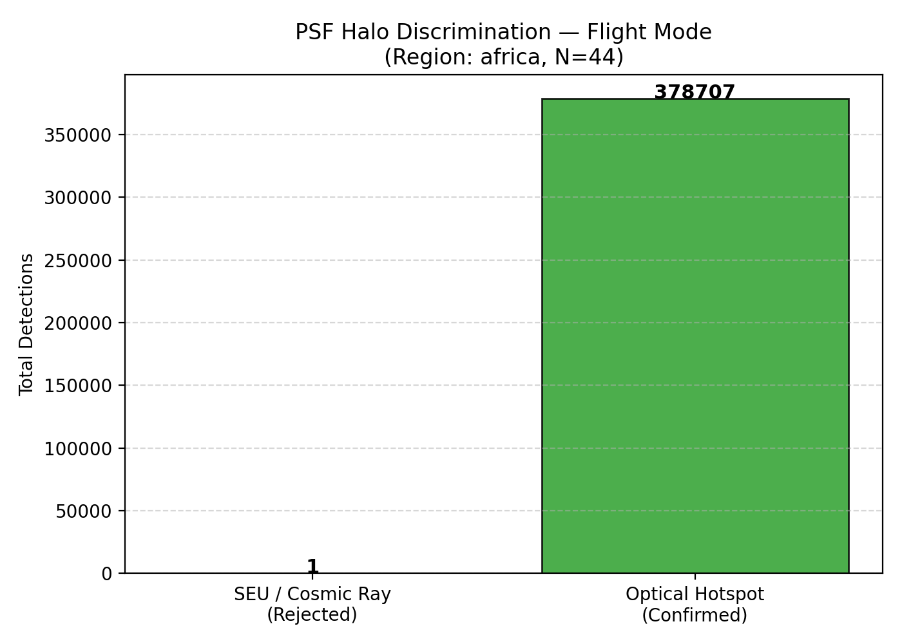
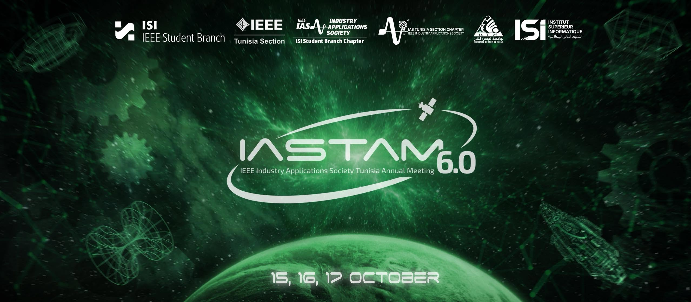

<p align="center">
  
</p>

<div align="center">

# 🛰️ Thermal-Edge-Fire: Autonomous Onboard Wildfire Intelligence

### High-Throughput Edge Segmentation & Downlink Prioritization for 6U CubeSats

[](https://python.org)
[](https://pytorch.org)
[](https://onnxruntime.ai)
[](https://docker.com)
[](https://render.com)
[](https://pytest.org)

<br/>


</div>

---

## 📌 Executive Summary

Modern Earth-Observation CubeSats equipped with Long-Wave Infrared (LWIR) microbolometers are severely constrained by **downlink bandwidth (< 1 Mbps over S/X-band)** and **ground station contact durations (8–10 minutes per pass)**. Transmitting uncompressed multispectral swaths (hundreds of megabytes) induces fatal latency in disaster response workflows.

**Thermal-Edge-Fire** implements an end-to-end autonomous edge-computing pipeline for a **6U CubeSat carrying an uncooled LWIR thermal sensor**. Anchored to flight precedents (**KITSUNE** CM3+ payload & **Chatar et al.** downlink-prioritization pipeline), it integrates a novel **Dual-Gate Validation Architecture** (pre-treatment input quality screening and post-treatment physical consistency verification) to guarantee data integrity, eliminate false alarms from space radiation, compress alert telemetry down to **64 bytes (1,600× bandwidth savings)**, and run within the 512 MB / 0.1 CPU power budget of an embedded space-grade system-on-chip.

---

## 🏛️ System Architecture: Dual-Gate Validation Pipeline

> 📄 **Full Engineering Dossier:** Detailed flight math, error bounds, and hardware benchmarks are available in [`docs/MODEL_ARCHITECTURE.md`](docs/MODEL_ARCHITECTURE.md).  
> 📓 **Production Training & Quantization Pipeline:** Complete reproducible training, temperature scaling, and INT8 ONNX export in [`notebooks/03_SPACETOON_IASTAM_MODEL_PROTOTYPE_PHASE3.ipynb`](notebooks/03_SPACETOON_IASTAM_MODEL_PROTOTYPE_PHASE3.ipynb).

The core innovation of the IASTAM architecture is that treatment (Planck calibration, NUC, neural network inference) is bounded by rigorous, deterministic guards **before** and **after** compute-intensive steps:

```
                      ┌─────────────────────────────────────────────────────────────┐
                      │                    ORBITAL SENSOR FEED                      │
                      └──────────────────────────────┬──────────────────────────────┘
                                                     ▼
                      ┌─────────────────────────────────────────────────────────────┐
                      │            GATE 1: PRE-TREATMENT INPUT QUALITY              │
                      │  • Detector health (NaN/Inf, dead scanlines, saturation)    │
                      │  • Flight PSF Spatial Halo Check (van Dokkum 2001)           │
                      │  • Cosmic Ray (SEU) vs Optical Hotspot discrimination        │
                      └──────────────────────┬──────────────────────┬───────────────┘
                                             │ (PASS)               │ (FAIL / REJECT)
                                             ▼                      ▼
                      ┌──────────────────────────────┐       ┌──────────────────────┐
                      │   SENSOR CONDITIONING / NUC   │       │ REJECT TELEMETRY     │
                      │  • Two-Point Calibration     │       │ • Error counter log  │
                      │  • Radiometric Inversion     │       │ • Zero downlink cost │
                      └──────────────┬───────────────┘       └──────────────────────┘
                                     ▼
                      ┌──────────────────────────────┐
                      │   EDGE NEURAL SEGMENTATION   │
                      │  • Quantized INT8 U-Net      │
                      │  • FP32 High-Fidelity Shadow │
                      └──────────────┬───────────────┘
                                     ▼
                      ┌─────────────────────────────────────────────────────────────┐
                      │           GATE 2: POST-TREATMENT PHYSICAL SANITY            │
                      │  • Thermal Contrast Verification: μ_fire / μ_bg ≥ 1.15       │
                      │  • Spatial Plausibility (speckle filter & collapse guard)    │
                      │  • Alert Packet Generation (64-byte CCSDS binary + CRC-16)  │
                      └──────────────────────┬──────────────────────────────────────┘
                                             ▼
                      ┌─────────────────────────────────────────────────────────────┐
                      │               PRIORITIZED DOWNLINK QUEUE                    │
                      │  Active Fire: 64B Alert Packet + Bounded ROI thumbnail      │
                      │  Nominal Ground: Discarded or lowest-priority background    │
                      └─────────────────────────────────────────────────────────────┘
```

---

## 🔬 Core Innovations & Mathematical Contracts

### 1. Gate 1 Flight Mode: PSF Spatial Halo Verification
Uncooled microbolometers in low Earth orbit are bombarded by radiation. Single-Event Upsets (SEUs) and cosmic ray hits produce localized intense pixel readouts that fool naive thresholding into false wildfire emergencies.

```
       Cosmic Ray / SEU (Sharp Transient)               True Wildfire (Optical PSF Halo)
               ▲                                                    ▲
               │          █                                         │           ▄█▄
               │          █                                         │          █████
               │          █                                         │        ▄███████▄
         ──────┴──────────█──────────►                        ──────┴───────███████████──────►
              Zero spatial dispersion                               Gaussian optical blur
          Rejected by Gate 1 (0 ms cost)                       Passed to Edge Segmentation
```

* True optical wildfires refract through sensor optics conforming to a Gaussian Point Spread Function with spatial dispersion:
  $$\sigma_{\text{PSF}} \ge 0.8\text{ pixels}$$
* Non-optical cosmic transients exhibit zero spatial halo and are rejected in $< 25\text{ ms}$ on an ARM Cortex-A72 without invoking the neural network.

<p align="center">
  
</p>

### 2. Radiometric Inversion & Conditioning
* Inverts Landsat-8 TIRS Planck equation from raw Digital Numbers ($DN$) to Kelvin ($T_B$):
  $$T_B = \frac{K_2}{\ln\left(\frac{K_1}{M_L \cdot DN + A_L} + 1\right)}$$
* Fixed-pattern noise (FPN) and dead sensor pixels are dynamically repaired via Two-Point Non-Uniformity Correction (NUC).

### 3. Gate 2: Thermal Contrast & Physical Consistency
To prevent false triggers over hot bare sand dunes (common in North African biomes):
* Requires active fire clusters to satisfy:
  $$\text{Contrast Ratio} = \frac{\mu_{\text{fire}}}{\mu_{\text{background}}} \ge 1.15$$
* Filters isolated 1-pixel artifacts and flags model collapse (e.g., > 50% frame detection).

<p align="center">
  
</p>

### 4. 64-Byte CCSDS-Compliant Alert Packet Protocol
When an active fire is validated, an ultra-compact binary packet is constructed:

```
Offset  Bytes  Field                Description
0x00      4    Magic Header         0x46495245 ('FIRE')
0x04      1    Protocol Version     0x07 (IASTAM V7)
0x05      1    Gate Status Flags    Bit 0: Gate 1 Pass | Bit 1: Gate 2 Pass | Bit 2: Fire Present
0x06      2    Sequence Counter     Monotonic frame counter (0..65535)
0x08      8    Timestamp            Unix epoch seconds (uint64)
0x10      4    Geo Latitude         IEEE-754 float32 centroid
0x14      4    Geo Longitude        IEEE-754 float32 centroid
0x18      4    Max Temperature      Kelvin float32
0x1C      4    Mean Fire Temp       Kelvin float32
0x20      2    Fire Pixel Count     Integer active pixels in patch
0x22      2    Cluster Count        Morphological contiguous fire fronts
0x24      2    Confidence Score     Detection probability (0..1000 scaled)
0x26     36    Telemetry Reserved   Orbit ephemeris, payload temps, solar vector
0x3E      2    CRC-16-CCITT         Polynomial 0x1021 error integrity check
Total: 64 Bytes
```

#### Bandwidth Comparison (TRD §F12 Baseline):
| Telemetry Mode | Payload Size | Compression Ratio | Downlink Pass Time (100 kbps) |
| :--- | :--- | :--- | :--- |
| **Raw 3-Channel 16-bit Patch** | **131,072 Bytes** | 1.0× (Baseline) | **10.48 seconds** |
| **Standard zlib DEFLATE** | **~3,500 Bytes** | 37.4× | **0.28 seconds** |
| **IASTAM Binary Alert Packet** | **64 Bytes** | **2,048×** | **0.005 seconds (< 10 ms)** |

---

## 🖥️ Interactive Web Demo (Gradio & Docker)

A standalone visual demo allows operators and jury members to test real Landsat-8 GeoTIFF patches, custom user imagery, and simulated orbital thermal scenes:

<p align="center">
  
</p>

### Key Features Implemented:
* **🛰️ Tab 1: Real-Time Edge Processing & Dual-Gate Audit**
  - Instant Gate 1 pre-screening (PSF halo analysis, dead pixel detection).
  - Neural segmentation using quantized Pereira U-Net (INT8 / FP32 selectable).
  - Gate 2 sanity verification with contrast ratio metric.
  - Interactive false-color thermal viewer, spatial RGB composite, and ground truth overlay.
* **📦 Tab 2: Downlink Packet Inspector & Telemetry Hex Dump**
  - Live hex dump viewer with byte-by-byte visual decoding.
  - CRC-16 checksum validation and zlib bandwidth reduction comparison (F12).
* **🔬 Tab 3: Model Parity & Architecture Benchmarks**
  - Pixel-by-pixel INT8 vs FP32 agreement percentage (F13).
  - Onboard memory scrub emulation (bit-flip protection).
  - Real-time latency benchmark on CPU threads.
* **🧪 Tab 4: Golden Verification & SHA-256 Model Integrity**
  - Validates ONNX model SHA-256 hashes against `CHECKSUMS.txt` (TRD §2.9).
  - Golden test reproducibility verification against pre-computed golden predictions (TRD §2.10).

---

## 🚀 Quickstart & Reproduction Guide

### 1. Local Python Environment
```bash
# Clone the repository
git clone https://github.com/kacemamine721-star/thermal-edge-fire.git
cd thermal-edge-fire

# Install dependencies
pip install -r requirements.txt

# Run the full test suite (43 tests across pipeline, math, and demo)
pytest -v
```

### 2. Launch the Web Demo Locally
```bash
cd demo
pip install -r requirements.txt
python app.py
# Opens at: http://127.0.0.1:7860
```

### 3. Run with Docker
```bash
# Build the production image with 512MB RAM constraint
docker build -t iastam-edge-demo demo/

# Run the container
docker run -p 7860:7860 --memory="512m" --cpus="1.0" iastam-edge-demo
```

---

## 📊 Dataset Triad & Training Strategy

| Dataset | Designated Pipeline Role | Technical Justification |
| :--- | :--- | :--- |
| **ActiveFire**<br>*(Pereira et al., Landsat-8)* | **Core Training & Segmentation**<br>218 patches + 882 multi-expert masks | Native LWIR (B10: 10.9 µm, B11: 12.0 µm) matching uncooled microbolometer physics at $256 \times 256$ resolution. |
| **TS-SatFire**<br>*(Zhao et al., Nature Sci Data 2025)* | **Domain Adaptation & Night Passes**<br>VIIRS 375 m time-series scenes | Matches coarse GSD of CubeSat uncooled optics; validates temporal progression. |
| **THRawS / PyRawS**<br>*(ESA-PhiLab, Sentinel-2)* | **Hardware-in-the-Loop (HIL) Realism**<br>Authentic Level-0 raw instrument telemetry | Tests Gate 1 on uncorrected telemetry containing detector striping and raw ADC artifacts. |

<p align="center">
  
</p>

---

## 📁 Repository Directory Structure

```
thermal-edge-fire/
├── docs/                        # Engineering Specifications & Flight Dossier
│   └── MODEL_ARCHITECTURE.md    # 6-Stage Edge Pipeline & Quantization Dossier
├── configs/                     # Central configuration & hyperparameters
│   └── config.yaml
├── demo/                        # Standalone Gradio Web Application
│   ├── models/                  # INT8 / FP32 ONNX weights, manifest, CHECKSUMS.txt
│   ├── sample_data/             # Landsat-8 sample patches, masks, golden test vectors
│   ├── img/                     # UI visual branding & logos
│   ├── app.py                   # Main Gradio application
│   ├── pipeline.py              # Dual-gate execution engine
│   ├── decode_packet.py         # Binary telemetry serializer/deserializer
│   ├── io_tiff.py               # Radiometric GeoTIFF loader
│   ├── metrics.py               # IoU, F1, Dice, and contrast evaluators
│   ├── Dockerfile               # Production container definition
│   └── render.yaml              # Render deployment blueprint
├── img/                         # High-resolution project imagery & diagrams
│   ├── iastam_banner.jpg        # Main wide header banner
│   ├── spacetoon_horizontal.png # SpaceTOON partner logo
│   └── spacetoon_icon.png       # Mission badge
├── notebooks/                   # Jupyter analysis & model pipelines
│   ├── 01_african_data_exploration.ipynb                   # Pan-African Landsat-8 exploration
│   ├── 02_SPACETOON_IASTAM_MODEL_PROTOTYPE_PHASE2.ipynb   # Phase 2 early prototype
│   └── 03_SPACETOON_IASTAM_MODEL_PROTOTYPE_PHASE3.ipynb   # Phase 3 production training & ONNX export
├── reports/
│   ├── figures/                 # Scientific plots, histograms, and matrices
│   ├── model_benchmarks/        # Final model latency, F1, and zero-shot benchmark CSVs
│   ├── africa_inventory.csv     # Pan-African curated patches
│   └── data_readiness_report.md # Gate 1 validation audit report
├── scripts/                     # Automated data extraction & verification scripts
├── src/fireedge/                # Core production Python package
│   ├── validation/              # Flight Gate 1, Ground Gate 1, and Gate 2
│   ├── preprocessing/           # NUC, Planck inversion, normalization
│   ├── data/                    # Datasets, DataModules, PanAfricanBatchSampler
│   └── io/                      # Landsat-8, VIIRS, and Sentinel-2 L0 readers
├── tests/                       # Unit & integration test suite (100% passing)
├── render.yaml                  # Root Render Blueprint
└── requirements.txt             # Primary Python dependencies
```

---

## 👥 Authors & Acknowledgments

* **SpaceTOON / IASTAM Project Team** : Rahma Trabelsi, Amine Kacem, Sahar Feki, Yessmine Chaabouni, Khaled Cheniour
* **Technical Supervision:** Space & Earth Observation AI Challenge (IASTAM 2026)
* **Defense Date:** October 15, 2026
* **Reference Foundations:** 
  - K. Chatar, K. Kitamura, and M. Cho, "Onboard Data Prioritization Using Multi-Class Image Segmentation for Nanosatellites," Remote Sens., vol. 16, no. 10, p. 1729, May 2024. doi: 10.3390/rs16101729.
  - G. H. de Almeida Pereira, A. M. Fusioka, B. T. Nassu, and R. Minetto, "Active fire detection in Landsat-8 imagery: A large-scale dataset and a deep-learning study," ISPRS J. Photogramm. Remote Sens., vol. 178, pp. 171–186, 2021, doi: 10.1016/j.isprsjprs.2021.06.002.
  - M. H. bin Azami, N. C. Orger, V. H. Schulz, T. Oshiro, and M. Cho, "Earth Observation Mission of a 6U CubeSat with a 5-Meter Resolution for Wildfire Image Classification Using Convolution Neural Network Approach," Remote Sensing, vol. 14, no. 8, p. 1874, Apr. 2022. DOI: 10.3390/rs14081874

---

<div align="center">
  <sub>Developed for the SpaceTOON CubeSat Wildfire Intelligence Mission · Built with PyTorch, ONNX, and Gradio</sub>
</div>
