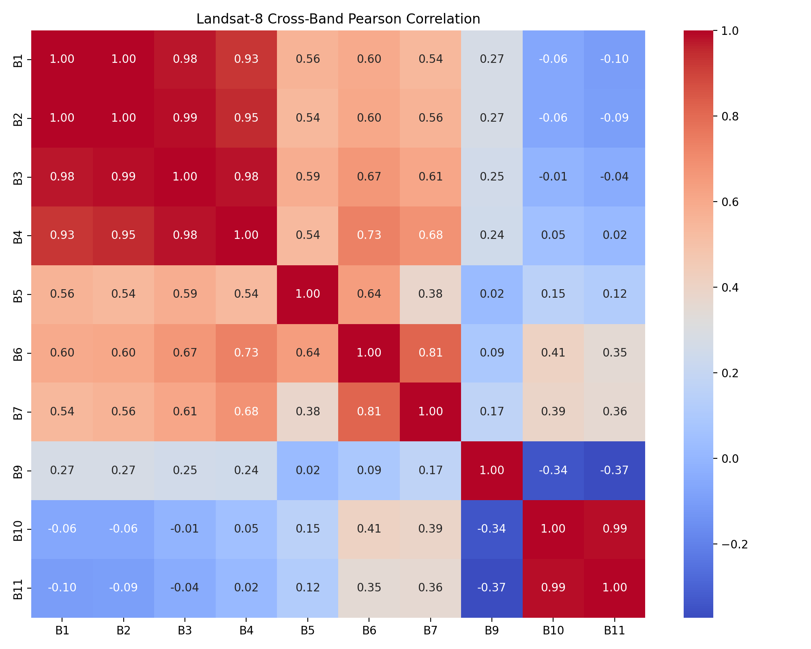
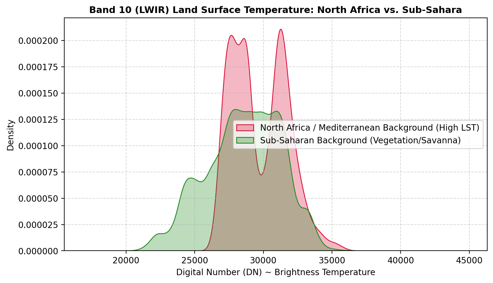

<p align="center">
  
</p>

<div align="center">

# <i class="fa-solid fa-satellite" style="color:#38bdf8; font-size:1.05em; vertical-align:-1px; margin-right:8px;"></i> Thermal-Edge-Fire: Onboard Wildfire Information Extraction

### A sensor-agnostic edge-processing architecture and multispectral proof of concept for 6U-class CubeSat missions

[](https://python.org)
[](https://pytorch.org)
[](https://onnxruntime.ai)
[](https://docker.com)
[](https://pytest.org)
[](https://thermal-edge-fire.onrender.com)

<br />


</div>

---

## <i class="fa-solid fa-circle-info" style="color:#38bdf8; font-size:1.05em; vertical-align:-1px; margin-right:8px;"></i> Read this scope note first

This repository is **not** a flight-qualified autonomous system or a validated
uncooled LWIR microbolometer payload. It is a software pipeline targeting a
6U-class CubeSat architecture and evaluated with three Landsat-8 configurations:
the primary **C7+C6+C2** multispectral model, a **B10-only thermal control**,
and a C7+C6+C2+B10 hybrid.

The primary configuration is a **Landsat-8 OLI-like three-band model**:

```text
Pereira-3C = C7 (SWIR2) + C6 (SWIR1) + C2 (Blue)
```

It validates the onboard information-extraction chain, but its inputs are not
the output of an actual CubeSat flight sensor. Its F1 = 0.9492 result must not
be presented as the performance of an LWIR microbolometer.

The B10-only model is an **evaluated thermal control experiment**, not future
work. On the Pereira voting-mask test split it obtains F1 = 0.4119. The voting
masks are generated by Landsat reflectance/SWIR algorithms, not thermal
algorithms. Consequently, this result measures the B10-to-label domain gap in
this benchmark; it neither validates nor rejects a future LWIR flight payload.
Mission-level LWIR claims require thermal-native labels or a carefully validated
simulated-raw dataset, followed by target-hardware measurements.

| Item | Status in this repository |
| --- | --- |
| 6U CubeSat edge-processing architecture | Proposed system architecture |
| Segmentation and information-product pipeline | Implemented software prototype |
| Primary validated model | Pereira-3C: C7+C6+C2, SWIR2/SWIR1/Blue |
| B10-only thermal model | Evaluated Landsat thermal control; not a flight microbolometer validation |
| ONNX FP32/INT8 export | Implemented and verified on the host |
| Raspberry Pi CM4 / flight-computer benchmark | Prepared, but not physically measured here |

---

## <i class="fa-solid fa-crosshairs" style="color:#38bdf8; font-size:1.05em; vertical-align:-1px; margin-right:8px;"></i> Problem and contribution

Earth-observation missions collect more imagery than can be transmitted during
short ground contacts. For wildfire response, the useful output is not every
pixel; it is a reliable, prioritized description of the events that matter.

Thermal-Edge-Fire addresses this as an **information-selection problem**:

```text
image frame → quality checks → segmentation → fire events → compact alert → priority queue
```

The project extends the segmentation work of the Pereira ActiveFire benchmark
and the onboard prioritization pattern of [Chatar et al.](https://www.mdpi.com/2072-4292/16/10/1729#app1-remotesensing-16-01729) with:

- input-quality screening and transient scrubbing;
- a lightweight U-Net edge model with FP32 and INT8 deployment paths;
- event extraction from the pixel mask rather than full-image downlink;
- compact binary alert packets with integrity checks;
- persistent priority buffering and retry across missed contacts; and
- explicit evaluation of accuracy, data reduction, latency, and robustness.

So the distinctive goal is **transmitting information rather than raw
data**.

---

## <i class="fa-solid fa-sliders" style="color:#10b981; font-size:1.05em; vertical-align:-1px; margin-right:8px;"></i> Six-stage processing architecture

The project implements a dual-gate architecture around the validated
multispectral model; the LWIR-specific calibration path remains a
payload-dependent extension.

```text
┌──────────────────────────────────────────────────────────────────────────┐
│ 1. Gate 1 — Input quality screening                                      │
│    Shape/type/range checks, dead columns, saturation, transient scrubbing │
└──────────────────────────────────┬───────────────────────────────────────┘
                                   ▼
┌──────────────────────────────────────────────────────────────────────────┐
│ 2. Sensor-dependent conditioning                                          │
│    Current model: Landsat reflectance normalization                        │
│    Future LWIR path: radiometric calibration, NUC, simulated-raw checks   │
└──────────────────────────────────┬───────────────────────────────────────┘
                                   ▼
┌──────────────────────────────────────────────────────────────────────────┐
│ 3. Lightweight neural segmentation                                        │
│    Tiny U-Net, 482,737 parameters, ONNX FP32/INT8                         │
└──────────────────────────────────┬───────────────────────────────────────┘
                                   ▼
┌──────────────────────────────────────────────────────────────────────────┐
│ 4. Probability calibration and decision threshold                         │
│    Temperature scaling and a recall-oriented operating point              │
└──────────────────────────────────┬───────────────────────────────────────┘
                                   ▼
┌──────────────────────────────────────────────────────────────────────────┐
│ 5. Event extraction                                                       │
│    Connected components, centroid/area/box/confidence/contrast features   │
└──────────────────────────────────┬───────────────────────────────────────┘
                                   ▼
┌──────────────────────────────────────────────────────────────────────────┐
│ 6. Gate 2, packet encoding, and downlink queue                            │
│    Physical plausibility checks, CRC, priority, persistence, and retry    │
└──────────────────────────────────────────────────────────────────────────┘
```

The architecture dossier is available at
[`docs/MODEL_ARCHITECTURE.md`](docs/MODEL_ARCHITECTURE.md).

---

## <i class="fa-solid fa-microchip" style="color:#10b981; font-size:1.05em; vertical-align:-1px; margin-right:8px;"></i> What the experiments established

### Band selection from paper and empirical result.

The band-information probe found that the Pereira voting masks are much more
closely aligned with the reflectance/SWIR inputs than with B10 thermal input:

| Band | Role | Pixel-level AUC |
| --- | --- | ---: |
| C7 / SWIR2 | Strong active-fire signal | **0.993** |
| B10 / thermal infrared | Thermal control | **0.865** |
| C6 / SWIR1 | Supporting spectral contrast | **0.820** |
| C2 / Blue | Supporting context | **0.565** |

This explains the selection of [Pereira-3C](https://www.sciencedirect.com/science/article/abs/pii/S092427162100160X) as the primary configuration. He explained it in detail in his article if you are curious.

<p align="center">
  
</p>

*Cross-band correlation provides sensor context; the AUC values above are the basis for the input-band selection.*

### Model results

The following values come from the final training and evaluation workflow in
[`notebooks/03_SPACETOON_IASTAM_MODEL_PROTOTYPE_PHASE3.ipynb`](notebooks/03_SPACETOON_IASTAM_MODEL_PROTOTYPE_PHASE3.ipynb)
and are reported against the Pereira voting-mask reference. Actually, they are not
field-ground truth for a flight sensor.

| Configuration | Input | Precision | Recall | IoU | F1 | Event recall |
| --- | --- | ---: | ---: | ---: | ---: | ---: |
| **Pereira-3C** | C7+C6+C2 | **0.9496** | **0.9489** | **0.9034** | **0.9492** | **0.9553** |
| B10 control | B10 only | 0.5534 | 0.3280 | 0.2593 | 0.4119 | 0.1326 |
| Hybrid control | C7+C6+C2+B10 | 0.9663 | 0.9263 | 0.8973 | 0.9459 | 0.9455 |

<p align="center">
  
</p>

*The thermal-background distributions illustrate why B10-only interpretation
must account for regional background conditions. It helpes us predict and understand why B10-only model didn't work well. This figure is contextual, the
configuration table above reports the segmentation results.*

An independent manual-label zero-shot test reports **F1 = 0.8493** and recall
**0.9590** for Pereira-3C. This is the more useful circularity check because
the training reference masks were generated by reflectance-band algorithms.

### Deployment and robustness results

- Tiny U-Net: **482,737 parameters**.
- INT8 model: approximately **514.8 KiB**; FP32 and INT8 outputs were verified
  against the deployment reference.
- End-to-end host benchmark: approximately **63.6 ms p50** and **77.7 ms p95**.
- These latency values are from an x86 host. They are **not** Raspberry Pi or
  flight measurements.
- Under the documented transient-noise stress test, Gate 1 scrubbing recovered
  F1 from approximately **0.67 to 0.94** at the tested severity level.
- In the 50%-capacity queue simulation, priority plus persistence/retry
  delivered **87.6%** of the top-20% urgent events, compared with **33.6%** for
  FIFO, with zero permanently lost packets for the persistent policies.

---

## <i class="fa-solid fa-box-archive" style="color:#38bdf8; font-size:1.05em; vertical-align:-1px; margin-right:8px;"></i> Information product and downlink reduction

For the current three-band, 256×256, 16-bit input tile:

```text
3 × 256 × 256 × 2 bytes = 393,216 bytes raw
```

The packet protocol extracts events rather than compressing the full image:

- **48 bytes** for a single-event alert;
- up to **183 bytes** for the documented six-event packet;
- **21 bytes** for a fire-free heartbeat;
- CRC-protected binary fields include timestamp, event count, coordinates,
  area, confidence, contrast, and status flags.

The corresponding ratios are **8,192×** for a 48-byte single-event packet and
**2,148.7×** for the 183-byte worst-case packet. The reported aggregate
simulation result is **6,234.99×** over 1,500 frames including heartbeats.
These are software/accounting results, not measured RF-link throughput.

The persistent queue keeps an alert for a later contact when the current
contact is missed and removes lower-priority records first when storage is
limited. This behavior is simulated and tested in software; orbital contact
geometry and a flight communications subsystem are outside the current scope.

---

## <i class="fa-solid fa-terminal" style="color:#38bdf8; font-size:1.05em; vertical-align:-1px; margin-right:8px;"></i> Interactive web demo

The Gradio demo makes the software pipeline inspectable for development and
defense. It accepts real Landsat-8 GeoTIFF patches and displays the input,
segmentation output, extracted events, packet fields, and reduction statistics.

<p align="center">
  
</p>

The demo includes:

- SWIR2/SWIR1/Blue false-color visualization and segmentation;
- Gate 1 quality checks and transient-scrub emulation;
- event clustering and compact packet inspection;
- CRC and packet-field decoding;
- FP32/INT8 parity and host latency benchmarking; and
- bundled golden vectors for reproducibility checks.

The demo is an engineering demonstrator. Its results should not be presented
as a live spacecraft or as a substitute for target-board validation.

---

## <i class="fa-solid fa-terminal" style="color:#38bdf8; font-size:1.05em; vertical-align:-1px; margin-right:8px;"></i> Quickstart

### Local environment

```bash
git clone https://github.com/kacemamine721-star/thermal-edge-fire.git
cd thermal-edge-fire
pip install -r requirements.txt
pytest -v
```

### Launch the web demo

```bash
cd demo
pip install -r requirements.txt
python app.py
# Open http://127.0.0.1:7860
```

### Run with Docker

```bash
docker build -t iastam-edge-demo demo/
docker run -p 7860:7860 --memory="512m" --cpus="1.0" iastam-edge-demo
```

The Docker resource limits are reproducibility settings for the demo; they do
not constitute a measured spacecraft power budget.

---

## <i class="fa-solid fa-layer-group" style="color:#38bdf8; font-size:1.05em; vertical-align:-1px; margin-right:8px;"></i> Dataset and validation strategy

| Dataset or source | Role | Scope |
| --- | --- | --- |
| Landsat-8 ActiveFire / Pereira et al. | Primary training and test reference | Pixel masks and multispectral patches; voting masks are reflectance/SWIR-derived |
| Manual fire annotations | Zero-shot check | Independent, algorithm-agnostic evaluation used to assess circularity |
| TS-SatFire / VIIRS | Secondary cross-sensor study | Planned comparison and temporal/domain-transfer work |
| Simulated-raw LWIR and THRawS-style data | Future payload validation | Required to quantify the real-versus-simulated sensor gap |

The final LWIR path requires labels generated from thermal-native information,
such as MODIS/VIIRS thermal fire products or a validated brightness-temperature
procedure. The current Pereira-3C score cannot be transferred to that path
without this additional validation.

---

## <i class="fa-solid fa-box-archive" style="color:#38bdf8; font-size:1.05em; vertical-align:-1px; margin-right:8px;"></i> Repository layout

```text
thermal-edge-fire/
├── docs/                         # Architecture and technical dossier
├── configs/                      # Shared configuration
├── demo/                         # Gradio app, ONNX models, packets, golden data
├── img/                          # Project imagery and diagrams
├── notebooks/                    # Dataset exploration and model pipelines
├── reports/                      # Inventories, figures, and benchmark outputs
├── scripts/                      # Dataset extraction and verification utilities
├── src/fireedge/                 # Validation, preprocessing, data, and I/O modules
├── tests/                        # Unit and integration tests
├── render.yaml                   # Deployment blueprint
└── requirements.txt              # Python dependencies
```

Useful entry points:

- [`demo/app.py`](demo/app.py) — interactive demonstration;
- [`demo/pipeline.py`](demo/pipeline.py) — production execution path;
- [`demo/decode_packet.py`](demo/decode_packet.py) — packet decoder;
- [`docs/MODEL_ARCHITECTURE.md`](docs/MODEL_ARCHITECTURE.md) — technical
  metrics and engineering specification; and
- [`reports/model_benchmarks/`](reports/model_benchmarks/) — reproducible
  benchmark outputs.

---

## <i class="fa-solid fa-gauge-high" style="color:#f59e0b; font-size:1.05em; vertical-align:-1px; margin-right:8px;"></i> Roadmap and known boundaries

1. Train and evaluate a model with LWIR-native labels rather than treating the
   B10 control as flight validation.
2. Add and quantify the microbolometer-specific raw-data path: radiometric
   calibration, two-point NUC, optical blur, noise, quantization, and resampling.
3. Run the ONNX/INT8 bundle on Raspberry Pi CM4-class or equivalent hardware
   and measure latency, memory, and energy per inference.
4. Complete hardware-in-the-loop validation for sensor faults, radiation-like
   transients, missed contacts, queue overflow, and retry behavior.
5. Add orbit/contact simulation and validate downlink performance against an
   actual communications budget.

Until those steps are complete, the defensible description is: **a validated
software information-extraction pipeline and a proposed 6U-class deployment
architecture, with LWIR as a future payload path**.

---

## <i class="fa-solid fa-satellite" style="color:#38bdf8; font-size:1.05em; vertical-align:-1px; margin-right:8px;"></i> Authors & Acknowledgments

* **SpaceTOON / IASTAM Project Team** : Rahma Trabelsi, Amine Kacem, Sahar Feki, Yessmine Chaabouni, Khaled Cheniour
* **Technical Supervision:** Space & Earth Observation AI Challenge (IASTAM 2026)
* **Defense Date:** October 15, 2026
* **Reference Foundations:** 
  - K. Chatar, K. Kitamura, and M. Cho, "Onboard Data Prioritization Using Multi-Class Image Segmentation for Nanosatellites," Remote Sens., vol. 16, no. 10, p. 1729, May 2024. doi: 10.3390/rs16101729.
  - G. H. de Almeida Pereira, A. M. Fusioka, B. T. Nassu, and R. Minetto, "Active fire detection in Landsat-8 imagery: A large-scale dataset and a deep-learning study," ISPRS J. Photogramm. Remote Sens., vol. 178, pp. 171–186, 2021, doi: 10.1016/j.isprsjprs.2021.06.002.
  - M. H. bin Azami, N. C. Orger, V. H. Schulz, T. Oshiro, and M. Cho, "Earth Observation Mission of a 6U CubeSat with a 5-Meter Resolution for Wildfire Image Classification Using Convolution Neural Network Approach," Remote Sensing, vol. 14, no. 8, p. 1874, Apr. 2022. DOI: 10.3390/rs14081874

---

<div align="center">
  <sub>SpaceTOON / IASTAM · Onboard information extraction for wildfire response</sub>
</div>
