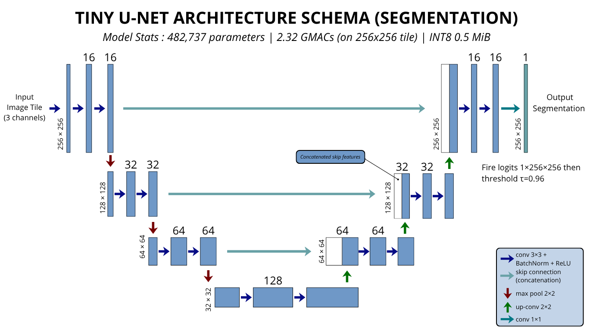

# IASTAM / Thermal-Edge-Fire
## Model Architecture, Evaluation Results, and Interactive Demo Technical Documentation

> **Project:** IASTAM / SpaceTOON, Thermal-Edge-Fire  
> **Challenge:** IASTAM 6.0, Track 4 (Networks and Communications), Problem 7 : *Transmitting Information Rather Than Raw Data*  
> **Intended deployment concept:** Edge processing for a 6U-class Earth-observation mission  
> **Primary evaluated configuration:** Pereira-3C (`C7 + C6 + C2`: SWIR2 + SWIR1 + Blue)  
> **Model family:** Tiny U-Net, ONNX Runtime FP32 and INT8  
> **Documentation date:** October 2026  
> **Repository:** <https://github.com/kacemamine721-star/thermal-edge-fire>

---

## 1. Scope and interpretation

Thermal-Edge-Fire is a **software prototype and evaluated information-extraction pipeline** intended to inform an onboard wildfire-detection architecture for a 6U-class CubeSat. It combines multispectral segmentation, input-quality screening, connected-component event extraction, binary alert packets, and software studies of downlink prioritization.

The results in this document describe the configurations and experiments available in this repository. They do **not** establish that the pipeline is flight-qualified, that it has been run on a CubeSat, or that it has been benchmarked on a Raspberry Pi Compute Module 4 or another flight computer.

The primary evaluated model, **Pereira-3C**, receives Landsat-8-style reflective bands C7/C6/C2. It is not an LWIR-microbolometer model. The B10-only configuration is a thermal-band control experiment evaluated against the same Pereira voting masks and against a small human-annotated set (Section 9). Its low score is a measured result, but it is **confounded** by (i) the reflectance/SWIR origin of the labels and (ii) the 100 m native resolution of Landsat-8 B10; this work does not separate the two causes (Section 6.3). It therefore neither validates nor rules out a properly calibrated thermal payload.

| Item | Status supported by this repository |
|---|---|
| Six-stage edge information-extraction architecture | Implemented software prototype |
| Pereira-3C Tiny U-Net | Trained and evaluated against the Pereira voting-mask benchmark (single training run, seed 42) |
| B10-only thermal input | Evaluated control configuration; not an LWIR flight-payload validation |
| Pereira-3C + B10 hybrid | Evaluated comparison configuration |
| ONNX FP32 and INT8 export | Exported, verified against PyTorch on 1,500 test frames, executable in the demo on a compatible host |
| Raspberry Pi CM4 / flight-computer performance | Not measured in this repository (benchmark bundle prepared) |
| Flight sensor, spacecraft power, radiation qualification, orbital operations, RF link | Not validated end to end |

The central contribution is the **information-extraction chain**, turning an image tile into structured event information, rather than a claim that a specific spacecraft sensor has already been validated in orbit.

## 2. Executive summary

### 2.1 Headline results

All test-split metrics below are on 4,781 held-out tiles (3,946 voting-fire, 835 voting-zero). Intervals are 95% Wilson intervals computed from the reported counts; they capture tile-sampling uncertainty only, not training-seed or scene-level variability.

| Metric | Result | What the result means |
|---|---:|---|
| Pereira-3C parameters | 482,737 | Tiny U-Net |
| Pereira-3C computation | 2.31945 GMAC per 256×256×3 tile | Model-compute estimate |
| INT8 ONNX file | 527,200 bytes (≈ 514.8 KiB) | Model-file size |
| FP32 ONNX file | 1,937,578 bytes (≈ 1.85 MiB) | INT8 file is ≈ 3.68× smaller |
| Test pixel F1 / IoU | 0.94925 / 0.90340 | Pixel masks at the selected threshold, vs. Pereira voting masks |
| Test frame recall | 0.96477 (3,807 / 3,946; CI 95.9–97.0%) | Fraction of voting-fire tiles with ≥ 1 predicted fire pixel |
| Test frame false-alarm rate | 0.06347 (53 / 835; CI 4.9–8.2%) | Fraction of **voting-zero** tiles raised as alarms (see Section 4.4 for what these tiles are) |
| Event recall / event precision | 0.95525 / 0.98362 | Tolerance-based (3 px) event metrics vs. the voting reference |
| Manual-label zero-shot F1 / recall | 0.84935 / 0.95899 | 100 human-annotated frames from 10 fire-containing scenes; precision 0.762 (Section 9) |
| Host pipeline latency | mean 65.68 ms; p50 64.38 ms; p95 77.68 ms; p99 91.30 ms | Intel Xeon 2.0 GHz host; **not** an onboard measurement |
| One-event packet | 48 bytes | Protocol accounting |
| Maximum six-event packet | 183 bytes | Protocol accounting |
| Fire-free heartbeat | 21 bytes | Optional heartbeat every 30 frames |
| Aggregate data reduction | 6,234.99× over 1,500 sampled test frames incl. heartbeats | Accounting on a fire-heavy sample (82% alert frames); see Section 12.4 for prevalence sensitivity |

### 2.2 Primary result in context

At their selected operating points, Pereira-3C has the highest test F1 and IoU of the three reported configurations. The hybrid configuration has higher pixel precision and a slightly higher F1 at the separate fixed-threshold comparison (`F1@0.25`: 0.9493 vs. 0.9486), and the F1 gap between Pereira-3C and the hybrid at the selected points (0.9492 vs. 0.9459) comes from a single training run per configuration, so it can't be presented as a demonstrated difference.

### 2.3 What the benchmark does and does not measure

1. The reference is an **algorithmic consensus** (≥ 2 of 3 reflectance/SWIR active-fire algorithms), not field truth. The 100-frame human-annotated set (Section 9) is an independent check against hand labels, but it is also image-based annotation, not field truth.
2. The test split is **fire-heavy** (82.5% voting-fire tiles) and all scenes were acquired in **one month** (6–30 August 2020).
3. The tiles labelled "fire-free" are in practice **no-consensus tiles**, 98% of them are tiles where exactly one of the three algorithms produced a mask (Section 4.4). The 6.3% frame false-alarm rate is a disagreement-with-consensus rate on those hard tiles; the false-alarm rate on truly empty scenes was **not measured**. It needs a dedicated benchmark of annotated fire-free scenes.
4. The deployment-relevant quantities (downlink bytes per orbit, alerts per day, alert precision) depend on the true prevalence of fire tiles in orbit, which this benchmark does not reproduce. Section 12.4 gives an analytical sensitivity study.

## 3. Six-stage processing architecture

The software pipeline is organized into six stages. Gate 1 and Gate 2 are software safeguards around the segmentation model; they are not proof of radiation tolerance or physical qualification.

```text
┌───────────────────────────────────────────────────────────────────────────┐
│ 1. Gate 1 : Input-quality screening                                        │
│    Shape/finite checks, dead bands/columns, saturation; optional          │
│    isolated-saturated-pixel scrub and optional dead-column repair         │
│    (both off by default)                                                  │
└────────────────────────────────────┬──────────────────────────────────────┘
                                     ▼
┌───────────────────────────────────────────────────────────────────────────┐
│ 2. Fixed input normalization                                              │
│    DN → TOA-reflectance-style rescaling (no sun-angle correction).         │
└────────────────────────────────────┬──────────────────────────────────────┘
                                     ▼
┌───────────────────────────────────────────────────────────────────────────┐
│ 3. Neural segmentation                                                    │
│    Tiny U-Net through ONNX Runtime (FP32 or INT8).                         │
└────────────────────────────────────┬──────────────────────────────────────┘
                                     ▼
┌───────────────────────────────────────────────────────────────────────────┐
│ 4. Probability transformation and thresholding                            │
│    p = sigmoid(z / T), then threshold τ.                                   │
└────────────────────────────────────┬──────────────────────────────────────┘
                                     ▼
┌───────────────────────────────────────────────────────────────────────────┐
│ 5. Event extraction                                                      │
│    8-connected components; bounding box, centroid, area, confidence,       │
│    SWIR2 contrast; top 6 events kept.                                      │
└────────────────────────────────────┬──────────────────────────────────────┘
                                     ▼
┌───────────────────────────────────────────────────────────────────────────┐
│ 6. Gate 2 and packet generation                                           │
│    Output-sanity checks (valid probabilities, box geometry, area > 0,      │
│    warning if mask > 5% of tile); version-3 binary packet + CRC32.         │
└───────────────────────────────────────────────────────────────────────────┘
```

The repository also contains a software model of a persistent, priority-based downlink queue (Section 13). The queue study is separate from the six per-tile inference stages and does not simulate a validated flight radio or orbital contact schedule.

### Stage 1 : Gate 1 input-quality screening

Checks implemented in the notebook reference (the demo port is described in Section 3.1):

| Check | Action |
|---|---|
| Wrong shape / non-finite values | Reject |
| Valid area (any band non-zero) < 5% of tile | Reject |
| A band is constant over the valid area (dead channel) | Reject |
| A band ≥ 50% saturated (DN = 65,535) | Reject |
| A band 2–50% saturated | Flagged |
| Dead columns (all zero in one band while other bands have data) in > 20% of columns | Reject |
| 1–20% dead columns | Reported in reasons; **not repaired** in the evaluated notebook run (the demo has an optional interpolation repair, off by default and not evaluated; Section 3.1) |
| Isolated saturated pixels (≤ 1 saturated neighbour in the 3×3 window) | Counted, replaced by the 3×3 median only if `scrub=True` (default **False** to maintain scientific accuracy) |

Scrubbing is off by default because an intense one-pixel fire can saturate SWIR2 and be indistinguishable from a transient (Section 11). The robustness experiments inject synthetic noise, transient spikes, dead columns and quantization. They are software stress tests, not physical radiation testing, and they show that dead columns remain highly damaging because, in the evaluated configuration, Gate 1 flags but does not repair them.

### Stage 2 : Fixed input normalization

For the reflective bands (C7, C6, C2) the model path applies

$$
x = \operatorname{clip}\left(DN \times 2.0\times10^{-5} - 0.1,\; 0,\; 1.6\right)
$$

with float32 output in [0, 1.6]. This is the USGS Level-1 rescaling to top-of-atmosphere planetary reflectance **without** the sun-elevation correction, ρ′ = M<sub>ρ</sub>·Q<sub>cal</sub> + A<sub>ρ</sub> (USGS, *Using the USGS Landsat Level-1 Data Product*), with the OLI metadata values M<sub>ρ</sub> = 2.0×10⁻⁵ and A<sub>ρ</sub> = −0.1. The same function is used for training, evaluation, ONNX calibration and the pipeline, so there is no train/deploy skew. The B10-only and hybrid configurations additionally convert B10 DN to brightness temperature with the TIRS constants (ML = 3.342×10⁻⁴, AL = 0.1, K1 = 774.8853, K2 = 1321.0789) and scale it as (T − 300 K)/30, clipped to [−3, 6]; the notebook sanity check maps DN 30,397 to 304.55 K.

Because there is no sun-angle correction, the normalization is a fixed contract, not a physically complete reflectance product. A flight sensor will need its own DN contract (Section 17).

### Stage 3 : Neural inference

The ONNX Runtime CPU session takes one float32 tensor `[1, 3, 256, 256]` (static batch 1, input name `bands`, output name `fire_logits`) and returns logits for a 256×256 mask. The interactive app can select the bundled Pereira-3C INT8 or FP32 model. The bundle contains only these two Pereira-3C ONNX files; there are no separate B10-only or four-channel hybrid ONNX models.

### Stage 4 : Temperature scaling and decision threshold

The code applies scalar logit temperature scaling followed by the sigmoid:

$$
p = \sigma(z/T), \qquad \sigma(u)=\frac{1}{1+e^{-u}}
$$

For Pereira-3C, `T = 2.1227591254` and the selected threshold is `τ = 0.96` (on the temperature-scaled probability). Selection protocol, validation trade-offs and the meaning of "calibrated" are in Section 7. The B10 control and hybrid have their own temperatures and thresholds; do not apply the Pereira-3C threshold to other configurations.

### Stage 5 : Connected components and event features

8-connectivity labelling; for each component the pipeline computes a pixel-space bounding box, centroid, pixel area, area in 0.1 ha units from the supplied GSD (default 30 m), a mean-probability confidence, and a SWIR2 contrast metric. Events are sorted by confidence then area and at most six are transmitted; the demo records how many more were dropped (Section 12.5). `MIN_EVENT_PIXELS = 1`: single-pixel detections are retained, and Section 8.3 shows why (raising the minimum to 2 pixels cuts frame recall from 0.966 to 0.696 on the pipeline sample). Geolocation comes from the GeoTIFF affine transform/CRS when valid; otherwise the event carries a no-geolocation flag.

**Confidence semantics.** In the notebook, event confidence is the mean temperature-scaled pixel probability inside the component, optionally mapped through an **event-level isotonic table** (per predicted-size class, fitted on the validation calibration scenes; Section 8.4). The table is installed before the pipeline cell runs, so packets written by the notebook carry the isotonic-calibrated value (the sample packet's 0.9885 is below the ≈ 0.9998 raw mean probability of a one-pixel event). Confidence therefore means *probability that the event agrees with the SWIR-voting reference within 3 px*, not probability of a real wildfire. The demo applies the raw mean probability without the table (Section 3.1), so its packets carry a different confidence value from the notebook's.

### Stage 6 : Gate 2 and packet encoding

`Gate2` rejects the output if the probability map is non-finite or outside [0, 1], if an event box leaves the 256×256 frame, or if an event's `area_ha_x10` is ≤ 0. It raises only a **warning** when more than 5% of the tile is above threshold. Passing Gate 2 is a software consistency check; it does not test whether a detection is physically a wildfire (there is no thermal-contrast or cloud/glint test in the current implementation). In the notebook run, the `area_ha_x10 ≤ 0` rejection interacts with the packet's 0.1-ha quantization at fine ground sampling (Section 12.5); the demo floors the area field at 1.

The packet encoder writes a little-endian version-3 binary packet with a CRC32 checksum (Section 12).

## Notebook reference versus demo implementation

The demo (`demo/pipeline.py`) is a port of the notebook pipeline and was checked against it line by line for this revision. Model, normalisation, temperature, threshold, Gate 1 checks (per-band, transients in every band), the event contrast metric (p95 of C7 reflectance in the component minus the median of a 5-pixel ring), 8-connected labelling, Gate 2, event ordering and the version-3 packet layout are the same. The event-level metrics in `demo/metrics.py` use the notebook's matching (8-connected clusters, 3-pixel dilation). The remaining differences, none of which changes the pixel-level or frame-level results of Sections 6–12 (those come from the notebook):

| Aspect | Notebook run behind Sections 6–12 | Demo |
|---|---|---|
| Event confidence | Mean probability mapped by the isotonic table | Raw mean temperature-scaled probability (table not loaded) |
| Event area field | `round(px · gsd² / 1000)`, can be 0 below about 22 m GSD (Gate 2 then rejects the event) | Floored at 1 |
| Events beyond six | Dropped without a count | Dropped; the number dropped (saturating at 15) is stored in bits 4–7 of the last event's flags byte; layout and byte counts unchanged |
| Dead-column repair | None (flag only) | Optional linear interpolation, **off by default**, not part of any reported result |
| Decoder on a bad packet | Raises on CRC or length mismatch | Returns `crc_valid` / `length_valid` so the UI can display the failure |

The demo's reference comparison for a single tile (pixel and event metrics against the voting mask) is an illustration and must not be quoted as the test-set result; the test-set values are in Sections 6 and 8.

## 4. Sensor bands, dataset and labels

### 4.1 Compared configurations

| Configuration | Input channels | Purpose in the experiment |
|---|---|---|
| `pereira3c` | C7 + C6 + C2 | Primary reflective-band configuration: SWIR2, SWIR1, Blue |
| `b10` | B10 | Thermal-band control |
| `pereira3c_b10` | C7 + C6 + C2 + B10 | Hybrid comparison |

C7, C6 and C2 are Landsat-8 Band 7 (SWIR2, 2.2 µm), Band 6 (SWIR1, 1.6 µm) and Band 2 (Blue). Landsat-8 Band 10 is a thermal-infrared band with a native ground resolution of about 100 m, distributed resampled to a 30 m grid; resampling does not provide native 30 m thermal detail (USGS band-designations reference).

### 4.2 Physical motivation and limits

Wien's displacement law for an ideal blackbody,

$$
\lambda_{\max} \approx \frac{2898}{T}\;\mu\mathrm{m},
$$

places the idealized radiance peak of a 300 K body near 9.7 µm and that of 800-1200 K material near 3.6-2.4 µm, which helps explain why SWIR is informative for hot combustion. It does not prove that SWIR outperforms thermal sensing for every instrument, scene or fire condition: real measurements depend on sub-pixel mixing, atmosphere, reflected sunlight, spectral response, saturation and spatial resolution.

**Band-information probe.** For each cached band the probe takes the local anomaly (pixel minus its 31×31 local mean) and measures how well that single feature separates voting-fire pixels from the rest (1,500 validation patches, 11,703 fire pixels, negatives sub-sampled and re-weighted):

| Band | Role | Pixel-level AUC | Best single-threshold pixel F1 |
|---|---|---:|---:|
| C7 / SWIR2 | Strong input signal | **0.99276** | 0.638 |
| B10 / thermal infrared | Thermal control | 0.86520 | 0.010 |
| C6 / SWIR1 | Supporting spectral context | 0.82013 | 0.156 |
| C2 / Blue | Supporting visible context | 0.56489 | 0.000 |

These results support choosing C7/C6/C2 for this **specific benchmark**. They do not establish that reflective-band algorithms are the correct ground truth for thermal sensing. A single-band anomaly rule on C7 reaches F1 0.64; the remaining gain to F1 0.95 comes from the learned multi-band, spatial model.

### 4.3 Dataset: Landsat-8 ActiveFire (Pereira et al., 2021), Africa subset

27,729 patches of 256×256 pixels (30 m GSD, 16-bit DN) from 514 parent scenes with 513 distinct WRS-2 path/rows, all acquired **6–30 August 2020**. Fire-pixel counts per patch have median 3, mean 8.85 and maximum 630; the mean fire-pixel fraction over all patches is ≈ 0.0135%.

| Split | Voting-fire tiles | Voting-zero tiles | Total tiles | Positive proportion | Scenes |
|---|---:|---:|---:|---:|---:|
| Train | 15,377 | 3,554 | 18,931 | 81.24% | 360 |
| Validation | 3,177 | 840 | 4,017 | 79.09% | 77 |
| Test | 3,946 | 835 | 4,781 | 82.51% | 77 |
| **Total** | **22,500** | **5,229** | **27,729** | **81.14%** | **514** |

The split is by parent scene (70/15/15, seed 42). In the inventory, **no path/row appears in more than one split**, so the same ground location is never present in both training and test. Neighbouring path/rows overlap spatially (Landsat side-lap), so a small residual spatial dependence between splits cannot be excluded. The validation set is further split by scene into a temperature-calibration half (VAL-CAL: 31 scenes, 1,848 patches, 388 voting-zero) and a selection half (VAL-SEL: 46 scenes, 2,169 patches, 452 voting-zero).

Train fire-size composition (voting-fire pixels per patch): 0 px 18.8%, 1–5 px 49.2%, 6–25 px 24.3%, 26–100 px 6.7%, > 100 px 1.1%. Roughly half of all training tiles contain only one to five fire pixels.

### 4.4 Labels and what a "fire-free" tile is

Labels are the Pereira **voting masks**: a pixel is fire if at least two of three algorithms (Kumar-Roy, Murphy, Schroeder) mark it. All three are reflectance/SWIR-based; thermal B10 plays no role in the label (manifest: "no thermal band involved").

The patch inventory shows how the voting-zero class arises:

| Algorithm masks available for the patch | Voting-fire | Voting-zero |
|---:|---:|---:|
| 1 | 0 | 5,138 |
| 2 | 4,815 | 91 |
| 3 | 17,685 | 0 |

A vote of two cannot be reached when only one algorithm produced a mask, so 98.3% of the "fire-free" tiles (5,138 of 5,229; 815 of 835 in the test split) are tiles on which **exactly one SWIR algorithm fired** and consensus failed. They are hard, ambiguous negatives, not empty scenes. This matters in two directions: the 6.3% frame false-alarm rate is a measure of agreement with a stricter consensus on tiles where a SWIR algorithm itself saw something; and the benchmark contains no clean empty-scene negatives, so the false-alarm rate on genuinely empty orbit data is unknown.

The positive-tile proportion is high in all splits. Frame false-alarm rate on voting-zero tiles is not the same as the false-alert workload of a deployed system (Section 12.4).

## 5. Model architecture, training and selection

### 5.1 Tiny U-Net

<p align="center">
  
</p>

| Element | Specification |
|---|---|
| Encoder | 3 levels, widths 16 / 32 / 64, each block = 2 × (3×3 conv, bias off, BatchNorm, ReLU); 2×2 max-pool between levels |
| Bottleneck | 128 channels |
| Decoder | 2×2 stride-2 transposed convolutions, skip-connection concatenation, same blocks (64 / 32 / 16) |
| Output | 1×1 convolution, **logits** (sigmoid applied after temperature scaling); no dropout |
| Input | `[B, C, 256, 256]`, C = 3 (primary), 1 (B10), 4 (hybrid) |

| Configuration | Parameters | GMAC / tile |
|---|---:|---:|
| `pereira3c` | 482,737 | 2.31945 |
| `b10` | 482,449 | 2.30058 |
| `pereira3c_b10` | 482,881 | 2.32889 |

The three configurations differ only in the first convolution, so parameter count and compute are essentially identical. Model-file sizes:

| Artifact | Size | Notes |
|---|---:|---|
| `unet_pereira3c_fp32.onnx` | 1,937,578 bytes (≈ 1.85 MiB) | FP32 |
| `unet_pereira3c_int8.onnx` | 527,200 bytes (≈ 514.8 KiB) | Static INT8 (QDQ, per-channel, MinMax calibration on 512 VAL-CAL frames, 435 with fire) |
| File-size reduction | ≈ 3.68× | File comparison only |

A model file's byte size does not show that the runtime, activations, workspace and operating system fit a given SRAM or cache; no onboard peak-memory or power measurement exists.

### 5.2 Training recipe

| Setting | Value |
|---|---|
| Optimizer | AdamW, lr 1e-3, weight decay 1e-4; ReduceLROnPlateau (factor 0.5, patience 3, monitored on validation loss) |
| Epochs / batch | 20 epochs, batch 16, 1,184 steps per epoch; early-stopping patience 12 (not triggered) |
| Loss | 0.3 · BCE (pos_weight 10) + 0.7 · Focal Tversky (α = 0.3 on false positives, β = 0.7 on false negatives, γ = 0.75, smoothing 1 pixel) |
| Sampling | Explicit target shares per patch fire-size bucket: 0 px 15%, 1–5 px 45%, 6–25 px 25%, 26–100 px 10%, > 100 px 5% (natural shares 18.8 / 49.2 / 24.3 / 6.7 / 1.1%) |
| Augmentation | Random horizontal/vertical flips and 90° rotations |
| Precision | Mixed precision (fp16 forward, FP32 loss), gradient clipping at 1.0; no batches with non-finite loss occurred |
| Hardware / time | One Tesla T4 (Kaggle GPU); ≈ 112–143 s per epoch (≈ 40 min per configuration) |
| Seed | 42; **one run per configuration** |

The training history records validation F1 at the best threshold per epoch. Validation F1 fluctuates by up to ±0.01 between consecutive epochs for Pereira-3C (e.g. 0.9550 at epoch 13, 0.9454 at epoch 15, 0.9575 at epoch 19), and its best-F1 threshold jumps between 0.05 and 0.99 because the F1 surface is flat; this is why thresholds are selected on a plateau (Section 7) rather than at the arg-max.

### 5.3 Epoch and threshold selection (mission-driven)

1. Validation is split **by scene** into VAL-CAL and VAL-SEL.
2. For each of the top five epochs by validation F1, a temperature is fitted on VAL-CAL and the threshold is chosen on VAL-SEL.
3. Epochs are ranked by: constraints met → fewest constraint violations → event recall (rounded to 0.001) → fewer false events per fire-free tile → 1–5 px event recall → pixel F1.
4. The test split is evaluated once, after selection.

For Pereira-3C the five candidates have VAL-SEL event recall between 0.951 and 0.956 and pixel F1 between 0.951 and 0.955. Epoch 11 was selected (event recall 0.956) although epoch 19 has the highest validation F1; the differences among candidates are within noise, so the choice of epoch is not a driver of the headline result.

## 6. Held-out test results across configurations

Values from the test results by configuration at each configuration's selected operating point :

| Configuration | Bands | Threshold | Precision | Recall | IoU | F1 | Frame recall | Frame FAR | Event recall | Event precision | Constraints met on validation |
|---|---|---:|---:|---:|---:|---:|---:|---:|---:|---:|---|
| **`pereira3c`** | C7+C6+C2 | 0.96 | 0.94957 | 0.94892 | 0.90340 | **0.94925** | 0.96477 | 0.06347 | 0.95525 | 0.98362 | Yes |
| `b10` | B10 | 0.29 | 0.55338 | 0.32798 | 0.25933 | **0.41186** | 0.18018 | 0.02635 | 0.13263 | 0.83008 | No |
| `pereira3c_b10` | C7+C6+C2+B10 | 0.60 | 0.96627 | 0.92634 | 0.89733 | **0.94589** | 0.96427 | 0.06707 | 0.94545 | 0.98402 | Yes |

### 6.1 Interpretation

1. **Pereira-3C is the primary result.** F1 0.94925, IoU 0.90340; frame recall 96.5% and frame FAR 6.3% on the benchmark.
2. **The hybrid does not improve on Pereira-3C here.** It has higher precision (0.966) and lower recall (0.926); its event recall (0.945) and 1–5 px event recall (0.934 vs 0.946) are lower. With one run per configuration and labels that exclude any thermal information, this comparison cannot show whether B10 would help against thermal-native labels.
3. **B10-only fails against these labels.** Frame FAR is lower (2.6%) but frame recall is 18.0% and event recall 13.3%; the selection constraints were infeasible on validation (best feasible threshold was a FAR-limited fallback).
4. `F1@0.25` is 0.94864 for Pereira-3C and 0.94931 for the hybrid.

### 6.2 Results by fire size (Pereira-3C, test split)

| True fire pixels in tile | Tiles | Frame recall | Pixel recall | Pixel precision | Pixel F1 |
|---|---:|---:|---:|---:|---:|
| 0 px (voting-zero) | 835 | FAR 0.0635 | – | – | – |
| 1–5 px | 2,515 | 0.9447 (139 missed tiles) | 0.9168 | 0.9498 | 0.9330 |
| 6–25 px | 1,098 | 1.0000 | 0.9484 | 0.9560 | 0.9522 |
| 26–100 px | 303 | 1.0000 | 0.9613 | 0.9493 | 0.9552 |
| > 100 px | 30 | 1.0000 | 0.9533 | 0.9495 | 0.9514 |

All 139 missed fire tiles are in the 1–5 px bucket. The 30-tile and 303-tile buckets give exact 95% lower bounds on frame recall of 0.884 and 0.988 respectively (observed 100%), so "100% for tiles with more than 100 fire pixels" rests on 30 tiles.

### 6.3 Why B10 fails ?

B10-only results by fire size (test split):

| True fire pixels in tile | Frame recall | Event recall (reference events) |
|---|---:|---:|
| 1–5 px | 0.044 | 0.053 (7,137 events) |
| 6–25 px | 0.307 | 0.455 (1,343 events) |
| 26–100 px | 0.772 | 0.823 (175 events) |
| > 100 px | 1.000 | 1.000 (16 events) |

B10 recovers large fires and misses small ones. This pattern is what a 100 m native thermal pixel diluting a 30 m fire would produce, and it is also what SWIR-derived labels containing many marginal 1–5 px detections would produce. On the human-annotated set (Section 9), B10 also reaches only F1 0.399 and frame recall 0.43, essentially the same as on the voting masks (F1 0.412); because the annotators very probably worked from reflectance composites, this does not separate label modality from resolution either. Earlier B10-only iterations with smaller models (base 8, ≈ 121 K parameters) and different data scales plateaued at F1 ≈ 0.35-0.41 in the project's earlier notebooks, which suggests the limit is the input/label pairing rather than model capacity; those earlier outputs are not part of this results package and must be cited from their own files if used.

## 7. Temperature calibration and operating-point selection

| Configuration | Temperature | Selected threshold | Selection rule | Validation constraints met |
|---|---:|---:|---|---|
| `pereira3c` | 2.122759 | 0.96 | `constrained_plateau_f1` | Yes |
| `b10` | 1.969283 | 0.29 | `infeasible_fallback_far_limited_plateau_f1` | No |
| `pereira3c_b10` | 2.177020 | 0.60 | `constrained_plateau_f1` | Yes |

**Procedure.** The temperature T minimises the pixel-level binary cross-entropy of σ(z/T) on VAL-CAL pixels (2,787,811 pixels for Pereira-3C; negatives sub-sampled to 1,500 per frame and re-weighted), within T ∈ [0.25, 20]. T > 1 shows the raw logits are over-confident. The threshold is the centre of the F1 plateau (F1 within 0.005 of the best) among thresholds that satisfy frame recall ≥ 0.95 and frame FAR ≤ 0.10 − 0.03 = 0.07 on VAL-SEL (the 3-point margin absorbs estimation noise). This is scalar temperature scaling, not Platt scaling.

**What the validation trade-off looks like (Pereira-3C, VAL-SEL: 1,717 fire tiles, 452 voting-zero tiles):**

| Threshold | Pixel F1 | Frame recall | Frame FAR |
|---:|---:|---:|---:|
| 0.50 | 0.9505 | 0.9744 | 0.0841 |
| 0.80 | 0.9522 | 0.9697 | 0.0752 |
| 0.90 | 0.9522 | 0.9621 | 0.0730 |
| 0.95 | 0.9519 | 0.9586 | 0.0664 |
| **0.96** | 0.9515 | 0.9575 | **0.0664** (30 / 452) |
| 0.97 | 0.9512 | 0.9540 | 0.0619 |
| 0.98 | 0.9506 | 0.9511 | 0.0619 |
| 0.99 | 0.9482 | 0.9406 | 0.0553 |

Frame FAR falls only from 8.4% to 5.5% across the whole threshold range while frame recall falls from 97.4% to 94.1%: on these tiles the false-alarm floor is set by the labels (Section 4.4), not by threshold choice. The test-split values at τ = 0.96 (FAR 6.35%, recall 96.5%) agree with validation.

**Meaning of "calibrated".** T is fitted on the benchmark's own pixel distribution (fire-heavy tiles, size-skewed). The calibrated probability is therefore calibrated for this distribution and these labels, not for the pixel prior or the empty-scene rate of an orbit. Validation selection does not guarantee behaviour under sensor shifts, season/biome shifts, new label policies or different fire prevalence.

## 8. Event-level evaluation

### 8.1 Event recall by reference-event size

Event matching: connected components of the reference mask and of the prediction are matched if any pixel of one lies within **3 pixels (Chebyshev, ≈ 90 m)** of the other. A reference event counts as found if some predicted pixel is within 3 px; a predicted event counts as false if no reference pixel is within 3 px.

| Reference component size | Reference events | Pereira-3C event recall | B10 event recall |
|---|---:|---:|---:|
| 1–5 pixels | 7,137 | 0.94564 | 0.05310 |
| 6–25 pixels | 1,343 | 1.00000 | 0.45495 |
| 26–100 pixels | 175 | 1.00000 | 0.82286 |
| More than 100 pixels | 16 | 1.00000 | 1.00000 |
| All reference events | 8,671 | **0.95525** (CI 95.1–95.9%) | 0.13263 |

These are tolerance-based benchmark results. A detection three pixels away counts as a hit, so event recall is a localisation-tolerant measure; pixel-level metrics (Section 6) use exact pixels. These values describe this test split, this matching rule and (for the largest buckets) small counts.

### 8.2 Event precision and false events

Event precision is 0.98362 (8,228 of 8,365 predicted events lie within 3 px of a reference event; 137 false events). False events per fire-free tile: 0.067; per tile overall: 0.029.

### 8.3 Minimum event size at the decision layer

The pipeline was re-scored on the 1,500-frame test sample while discarding predicted components smaller than a minimum size:

| Minimum event pixels | Frame recall | Frame FAR | Event precision | False events / tile | Event recall 1–5 px | 6–25 px | ≥ 26 px |
|---:|---:|---:|---:|---:|---:|---:|---:|
| **1 (current)** | 0.966 | 0.074 | 0.982 | 0.033 | 0.939 | 1.000 | 1.000 |
| 2 | 0.696 | 0.004 | 0.995 | 0.005 | 0.572 | 1.000 | 1.000 |
| 3 | 0.506 | 0.000 | 0.997 | 0.002 | 0.350 | 0.998 | 1.000 |

Suppressing one-pixel detections removes almost every false alarm but costs 27 points of frame recall, because about half of the fire-containing tiles hold only 1–5 fire pixels. The current design keeps single-pixel events. A minimum-size filter is the available lever if the mission prefers precision over recall. *(This is a post-hoc decision-layer filter; it is not the same as training only on large clusters.)*

### 8.3b Fire-size summary

Fire size therefore controls detectability: tiles with ≥ 6 fire pixels were detected without a miss in the test split; the residual recall loss (≈ 5.5% of fire tiles, ≈ 5.4% of events) is entirely in the one-to-five-pixel class, which is also the class closest to the labels' own uncertainty.

### 8.4 Event confidence

An isotonic mapping from mean calibrated probability to "event agrees with the voting reference" was fitted per predicted-size class on VAL-CAL (3,214 events) and evaluated on the test events (8,365).

| Predicted event size | Events | Observed real fraction | Mean raw confidence | Mean calibrated confidence |
|---|---:|---:|---:|---:|
| 1–5 px | 6,799 | 0.980 | 0.9985 | 0.981 |
| 6–25 px | 1,367 | 0.999 | 0.9992 | 0.984 |
| 26–100 px | 183 | 1.000 | 0.9991 | 0.976 |
| > 100 px | 16 | 1.000 | 0.9986 | 0.967 |

Expected calibration error on test: 0.0150 (raw mean probability) → 0.0020 (isotonic). However, 8,357 of the 8,365 test events fall in the single 0.9–1.0 confidence bin (observed real fraction 0.984). The confidence is well calibrated but **almost non-discriminating**: every event is reported at ≈ 0.97–0.99. Event-level priority therefore depends mainly on the contrast and area terms of the urgency score (Section 13.1).

## 9. Manual-label zero-shot evaluation

`manual_zero_shot` reports an evaluation, without fine-tuning, on the human-annotated frames of the Pereira manual-annotation release. The temperature and threshold are those fixed on the Africa validation set.

**Composition of the evaluated set.** 100 annotated frames from 10 scenes (September 2020; 1–38 frames per scene), **all containing fire**. None of the 10 scenes, or their path/row-and-date, appears in the Africa inventory, so there is no leakage from training. Because the set has no fire-free frames, the frame false-alarm rate is undefined (0 of 0), and the reported 0.00 must not be read as "no false alarms". (An earlier description of this set as "13 scenes, 10 with fire and 3 without" is not supported by the evaluation output and has been removed.)

| Configuration | Precision | Recall | IoU | F1 | Frame recall | Frame FAR | Event recall | Event precision |
|---|---:|---:|---:|---:|---:|---:|---:|---:|
| **Pereira-3C** | 0.76220 | 0.95899 | 0.73814 | **0.84935** | 0.99 (99 / 100) | n/a | 0.92897 | 0.80138 |
| B10 | 0.71537 | 0.27620 | 0.24886 | **0.39853** | 0.43 | n/a | 0.32759 | 0.92013 |
| Hybrid | 0.83863 | 0.94754 | 0.80142 | **0.88976** | 0.99 | n/a | 0.91103 | 0.81801 |

Per-scene frame alarms for Pereira-3C: 99 of 100 fire frames alarmed (the one miss is in scene `…025033…`, 37 of 38). For B10 only 43 of 100 frames alarmed (scene `…046021…` 0 of 4, `…134039…` 0 of 1, `…025033…` 4 of 38).

Reading: against human labels the model keeps recall (0.959) but precision drops from 0.950 to 0.762 and F1 from 0.949 to 0.849, i.e. it marks more fire pixels than the annotators did. The hybrid scores higher than Pereira-3C on this set (F1 0.890), the opposite order from the voting-mask test, on 100 frames, with one training run each; no ranking between the two should be drawn from either set. The set is small and geographically different from the Africa data, so it is a circularity check, not a flight validation.

## 10. Host latency, ONNX parity and runtime measurements

### 10.1 Model-only ONNX benchmark

`benchmark_host` (Intel Xeon 2.00 GHz, `is_onboard_measurement = False`; 50 timed runs after 10 warm-ups):

| Model | Threads | Mean | p50 | p95 | Model-file size |
|---|---:|---:|---:|---:|---:|
| FP32 | 1 | 46.08 ms | 45.69 ms | 49.07 ms | 1.85 MiB |
| FP32 | 4 | 24.19 ms | 24.01 ms | 25.86 ms | 1.85 MiB |
| INT8 | 1 | 55.21 ms | 54.65 ms | 58.80 ms | 0.503 MiB |
| INT8 | 4 | 32.17 ms | 31.60 ms | 36.16 ms | 0.503 MiB |

**On this host INT8 is slower than FP32** (about 20% at one thread, 33% at four) while being 3.68× smaller. INT8's benefit demonstrated here is storage and bandwidth, not speed; the speed on a Cortex-A72-class processor is unmeasured and depends on the available INT8 kernels. The CSV column `file_MB` holds MiB (bytes / 1,048,576).

### 10.2 FP32 versus INT8 parity (1,500 test frames: 1,220 with fire, 280 without)

| Model | Pixel F1 | Frame recall | Frame FAR | Alert-decision agreement vs. PyTorch | Mean abs. probability error |
|---|---:|---:|---:|---:|---:|
| PyTorch FP32 | 0.94888 | 0.96148 | 0.07857 | 1.00 | 0 |
| ONNX FP32 | 0.94888 | 0.96148 | 0.07857 | 1.00 | 3.2×10⁻¹¹ |
| ONNX INT8 | 0.94821 | 0.95984 | 0.08214 | 0.99 | 4.9×10⁻⁶ |

INT8 changes pixel F1 by −0.0007, frame recall by −0.0016 and frame FAR by +0.0036. About 1% of frame-level alert decisions (≈ 15 frames) differ from FP32, which is exactly at the acceptance limit used in the notebook (agreement ≥ 0.99, |ΔF1| ≤ 0.01, Δ frame recall ≥ −0.01, Δ FAR ≤ 0.01); INT8 was accepted and is the pipeline model.

### 10.3 End-to-end software pipeline benchmark

`pipeline_latency_host` (1,500 test frames, INT8 model, one inference thread):

| Stage | Mean | p50 | p95 | p99 |
|---|---:|---:|---:|---:|
| Gate 1 | 1.772 ms | 1.740 ms | 3.577 ms | 4.505 ms |
| Preprocessing | 0.332 ms | 0.314 ms | 0.473 ms | 0.577 ms |
| Inference | 57.492 ms | 57.043 ms | 61.011 ms | 69.806 ms |
| Decision / event extraction | 5.926 ms | 4.152 ms | 15.397 ms | 27.584 ms |
| Gate 2 | 0.152 ms | 0.147 ms | 0.186 ms | 0.230 ms |
| Packet encoding | 0.045 ms | 0.045 ms | 0.083 ms | 0.103 ms |
| **Total pipeline** | **65.677 ms** | **64.376 ms** | **77.680 ms** | **91.300 ms** |

Inference is 88% of the mean latency; the long tail of the decision stage comes from tiles with many connected components. The sum of stage means (65.72 ms) exceeds the total mean (65.68 ms) because frames that skip a stage do not contribute to that stage's mean. The reciprocal of the mean (≈ 15.2 tiles/s; 15.5 tiles/s from the p50 shown in the demo) is a host estimate and the 100 ms comparison figure is a project-level reference target. Embedded performance must be measured with the intended runtime, memory limits, input I/O and power configuration; the Raspberry Pi benchmark bundle (FP32/INT8 models, sample input, README with power-measurement procedure) is prepared but has not been run.

## 11. Synthetic robustness evaluation

`robustness_primary` evaluates the primary model (PyTorch FP32, selected T and τ) on 1,000 random test tiles (821 voting-fire, 179 voting-zero). Perturbations are applied to the raw uint16 DN before preprocessing:

| Perturbation | Level 1 / 2 / 3 |
|---|---|
| Noise (Gaussian, reflective bands) | σ = 100 / 300 / 800 DN (0.002 / 0.006 / 0.016 reflectance) |
| Quantization | 12 / 10 / 8 effective bits |
| Transients | 5 / 20 / 80 saturated (65,535) single pixels per frame, random band and position |
| Dead columns | 1 / 3 / 8 whole columns set to 0 in one band |

| Scenario | Pixel F1 | Pixel recall | Frame recall | Frame FAR | Event recall (all) | False events / tile |
|---|---:|---:|---:|---:|---:|---:|
| Clean, scrub off | 0.95174 | 0.95392 | 0.96590 | 0.06704 | 0.95800 | 0.025 |
| Noise L1 | 0.95072 | 0.95290 | 0.96711 | 0.06145 | 0.95800 | 0.022 |
| Noise L2 | 0.94470 | 0.94959 | 0.96955 | 0.07821 | 0.95627 | 0.040 |
| Noise L3 | 0.84410 | 0.92253 | 0.96955 | 0.31285 | 0.94476 | 1.351 |
| Quantization L1 | 0.95188 | 0.95431 | 0.96590 | 0.06704 | 0.95857 | 0.026 |
| Quantization L2 | 0.95233 | 0.95495 | 0.96711 | 0.06704 | 0.95915 | 0.026 |
| Quantization L3 | 0.95257 | 0.95737 | 0.96833 | 0.06704 | 0.96203 | 0.024 |
| Transients L1, scrub off | 0.86460 | 0.95354 | 0.99635 | 0.82123 | 0.95742 | 1.601 |
| Transients L2, scrub off | 0.67180 | 0.95227 | 1.00000 | 1.00000 | 0.95282 | 6.526 |
| Transients L3, scrub off | 0.35121 | 0.94946 | 1.00000 | 1.00000 | 0.95167 | 26.577 |
| Dead columns L1 | 0.38844 | 0.95124 | 0.97564 | 0.36313 | 0.95685 | 1.954 |
| Dead columns L2 | 0.17993 | 0.94703 | 0.98904 | 0.63687 | 0.95627 | 6.263 |
| Dead columns L3 | 0.07493 | 0.93963 | 0.99391 | 0.92737 | 0.94707 | 16.863 |
| Transients L2 + Gate 1 scrub | 0.94311 | 0.93937 | 0.96468 | 0.07263 | 0.95685 | 0.051 |
| Transients L3 + Gate 1 scrub | 0.93979 | 0.93925 | 0.96346 | 0.07263 | 0.95627 | 0.103 |
| **Clean + Gate 1 scrub** (printed as a second row labelled "clean" in the CSV) | 0.94468 | 0.93937 | 0.96468 | 0.06704 | 0.95685 | 0.025 |

### Interpretation

* **Gate 1 scrub works against injected transients, at a cost to real fires.** With 20 injected saturated pixels per frame, scrubbing moves pixel F1 from 0.672 to 0.943 and frame FAR from 1.000 to 0.073; with 80, from 0.351 to 0.940. On clean data, scrubbing lowers pixel recall from 0.954 to 0.939 and pixel F1 from 0.952 to 0.945 because isolated saturated pixels include real one-pixel fires. This is the reason scrubbing is off by default.
* **The model is very sensitive to isolated saturated pixels and dead columns.** Even five injected saturated pixels per frame push frame FAR to 0.82, and a single dead column in one band raises it to 0.36. In the evaluated configuration Gate 1 flags up to 20% dead columns but does not repair them. A linear-interpolation repair exists in the demo (off by default); its effect on these scenarios has not been measured, so no result is claimed for it.
* **Noise and quantization are tolerated up to the middle level.** Quantization to 8 bits has no measurable effect; noise at σ = 800 DN raises frame FAR to 0.31.
* These are synthetic input perturbations on one random sample, evaluated with the PyTorch model, without confidence intervals. They are not radiation tests, SEU/latch-up tests or a sensor-specific noise model (Landsat is not a microbolometer and no non-uniformity-correction stage is implemented).

## 12. Compact binary alert packet protocol

The packet format is version 3, little-endian, implemented in the notebook (`encode_packet` / `decode_packet`) and ported to `demo/pipeline.py`.

### 12.1 Packet layout

| Component | Size | Main contents |
|---|---:|---|
| Header (`<BBBIQBB`) | 17 bytes | Magic `0xF1`, version, model ID, frame ID (u32), acquisition timestamp ms (u64), event count, status flags |
| Event record (`<iiHHHHHHHHHB`) | 27 bytes each | Latitude and longitude (×10⁻⁷ degrees, i32), pixel box x, y, w, h, area in 0.1 ha units, confidence (u16), contrast metric (u16), GSD (m), geolocation uncertainty (m), event flags |
| CRC32 trailer | 4 bytes | CRC32 over header and event records |

The header carries a **model ID**, not a satellite ID. The format is a custom binary format, not a CCSDS Space Packet (CCSDS framing is future work). Header flags: input rejected (1), output rejected (2), input modified by Gate 1 (4: transient scrub; in the demo also dead-column repair), saturated input (8), Gate 2 warning (16), heartbeat (32), time unavailable (64), reference only (128). Event flags (bits 0–3): no geolocation (1), geolocation uncertainty unknown (2), spectral metric (4), thermal metric (8). Bits 4–7 of the event flags byte are unused in the evaluated notebook run; the demo uses them for the dropped-event counter (Section 12.5).

**Decoded sample packet** (first alert of the pipeline run, 48 bytes): one event, box 1×1 pixel at (245, 156), `area_ha_x10 = 1` (0.09 ha rounded to 0.1 ha), confidence 64,782 / 65,535 = 0.9885, SWIR2 contrast 2,089 / 10,000 = 0.209 reflectance, GSD 30 m, geolocation uncertainty 65,535 (unknown), event flags 6 (uncertainty unknown + spectral metric), header flags 64 (acquisition time unavailable: Landsat patches carry no timestamp, so the field is zero and flagged rather than invented).

### 12.2 Packet sizes and data-reduction arithmetic

For a 3-band 256×256 input tile of unsigned 16-bit samples:

$$
3 \times 256 \times 256 \times 2 = 393{,}216\text{ bytes}
$$

| Payload | Bytes | Ratio relative to the raw tile |
|---|---:|---:|
| Raw three-band input tile | 393,216 | 1× |
| Single-event alert | 48 | 8,192× |
| Six-event packet (maximum) | 183 | ≈ 2,148.7× |
| Empty/heartbeat packet | 21 | ≈ 18,724.6× |

### 12.3 Aggregate result and its sample

The recorded aggregate result is **6,234.99×** over 1,500 randomly drawn test tiles (589.8 MB raw → 94.6 KB sent, including heartbeats). The sample contains 1,233 alert tiles (82.2%), 5 heartbeats, 261 silent no-fire tiles and 1 health packet from a Gate 1 rejection; the mean alert packet is 76.62 bytes (5,132× per alert). The ratio is an accounting result on a **fire-heavy** sample; because 82% of the tiles produce a packet it is much lower than the ratio an orbit with few fires would give, while the *alert precision* of such an orbit would be much lower too (Section 12.4).

### 12.4 Analytical projection of sensitivity to fire prevalence

The measured numbers combine a high-prevalence sample with a false-alarm rate measured on hard "voting-zero" tiles. To show how they transfer, the table projects bytes per tile and alert precision for other prevalences *p* of fire-containing tiles, assuming: frame recall R = 0.965; frame FAR on non-fire tiles = 0.0635 (taken from the benchmark and therefore probably pessimistic for truly empty scenes, which were not measured); 76.62 bytes per true alert; 49.5 bytes per false alert (17 + 4 + 27 × 1.06 events); one 21-byte heartbeat per 30 silent tiles.

| Prevalence p | Bytes per tile | Reduction vs. 393,216 B | Alert tiles per 1,000 | Share of alert tiles that are real fires |
|---:|---:|---:|---:|---:|
| 82.5% (benchmark) | 61.7 | ≈ 6,400× (measured: 6,235×) | 807 | 98.6% |
| 10% | 10.8 | ≈ 36,000× | 154 | 62.8% |
| 1% | 4.5 | ≈ 87,000× | 72 | 13.3% |
| 0.1% | 3.9 | ≈ 102,000× | 64 | 1.5% |
| 0.01% | 3.8 | ≈ 103,000× | 64 | 0.15% |

The projected 6,400× at the benchmark prevalence agrees with the measured 6,235×, which supports the model. Two consequences: downlink *volume* is insensitive to prevalence once alerts are rare (a few bytes per tile), but the *share of alerts that are real* collapses unless the frame false-alarm rate on empty scenes is far below the benchmark's 6%. For alert precision ≥ 50% the frame false-alarm rate must be below about pR/(1 − p): ≈ 1% at p = 1%, ≈ 0.1% at p = 0.1%. Measuring false-alarm rate on genuinely empty, orbit-like scenes is the main outstanding evaluation.

### 12.5 Known packet-format limits

* `area_ha_x10` is rounded to 0.1 ha units. A one-pixel event at 30 m is 0.09 ha (stored as 1), but at a GSD below about 22 m a single pixel rounds to 0 and, in the evaluated notebook run, Gate 2 then **rejects** the event (`area_ha_x10 ≤ 0`). This is harmless at the Landsat reference GSD but would drop small events at the 5 m class GSD of KITSUNE-type payloads. The demo floors the field at 1 (a lower bound, not a measurement); a layout carrying the pixel count instead of 0.1-ha units remains future work.
* Events beyond six are not transmitted. The evaluated notebook run did not record how many were dropped. The demo stores the count, saturating at 15, in bits 4–7 of the flags byte of the last transmitted event; the version-3 layout and the 183-byte maximum are unchanged. This change was made after the evaluation run and does not affect the reported detection metrics or byte counts.
* The format is a custom binary format, not a CCSDS Space Packet.
* The area field is a detected-pixel footprint, not a burning area.

### 12.6 Heartbeat behaviour

The pipeline can send a 21-byte heartbeat on the first frame and every 30 frames to distinguish "no alert" from an inactive processor. The web app intentionally disables the heartbeat for single-tile runs so a fire-free tile shows zero-fire / no-packet behaviour.

### 12.7 Confidence and contrast interpretation

For Pereira-3C the contrast field is a scaled local SWIR2 reflectance contrast (reflectance × 10,000), not a thermal-radiance contrast; for B10 configurations it is brightness-temperature contrast in K × 100. The event flag states which. Confidence semantics are in Section 3 (Stage 5) and Section 8.4.

## 13. Downlink queue and prioritization study

### 13.1 Design and simulation set-up

Alerts are stored in a persistent SQLite queue (write-ahead logging; unsent "sending" records are returned to "queued" on restart). Three policies are compared: **A** priority order (urgency, descending) + persistence + retry; **B** FIFO + persistence + retry; **C** priority without persistence/retry (unsent packets are dropped at the end of each pass). The simulation uses the 1,239 packets produced by the pipeline run, spread uniformly over 48 h, 12 contact passes with per-pass outcomes drawn as lost contact (25%), link cut mid-pass (25%, packet in flight not acknowledged) or normal (50%); per-pass byte budget is a fraction of the total volume divided by the number of passes (stressed: 50% → 3,941 B per pass; ample: 150%); results are means over 30 random outcome sequences. Rebooting between every pass leaves the delivery outcome identical (persistence test). Priority is the urgency score

$$
u = \max_{\text{events}}\left(0.5\,c + 0.3\,\min\left(\tfrac{\Delta\rho_{\mathrm{SWIR2}}}{0.5},1\right) + 0.2\,\min\left(\tfrac{\ln(1+\text{area}_{ha})}{\ln 101},1\right)\right),
$$

with *c* the event confidence; health packets from rejected frames get 0.6.

### 13.2 Results (`queue_policy_comparison`)

| Regime | Policy | All packets delivered | Top-20% urgent delivered | Mean delay of delivered top-20% | Dropped permanently | Mean retries |
|---|---|---:|---:|---:|---:|---:|
| Stressed (50%) | A priority + persistence + retry | 23.5% | **87.6%** | 4.96 h | 0 | 2.17 |
| Stressed (50%) | B FIFO + persistence + retry | 31.6% | 33.6% | 17.87 h | 0 | 2.63 |
| Stressed (50%) | C priority, no persistence/retry | 26.5% | 66.6% | 1.93 h | 910.5 | 0 |
| Ample (150%) | A priority + persistence + retry | 82.1% | 99.4% | 3.21 h | 0 | 2.20 |
| Ample (150%) | B FIFO + persistence + retry | 85.3% | 87.2% | 6.87 h | 0 | 2.30 |
| Ample (150%) | C priority, no persistence/retry | 69.0% | 75.5% | 1.93 h | 384.4 | 0 |

### 13.3 How to read it

1. In the stressed regime, policy A delivers 87.6% of the top-20% urgent packets against 33.6% for FIFO, with a mean delay of 5 h instead of 18 h.
2. "Dropped permanently = 0" for A and B means nothing is discarded, **not** that everything is delivered: under 50% capacity A has delivered 23.5% of all packets by the end of the 48 h horizon and the remainder is still queued.
3. Policy A delivers *fewer* packets overall than FIFO in the stressed regime (23.5% vs 31.6%); it trades volume for urgency. The reason was not analysed.
4. The "top-20% urgent" set is defined by the same urgency score that orders policy A's queue, so A's advantage on that set is expected by construction; the result quantifies the size of the advantage, not whether prioritisation can identify truly urgent fires (event confidence is nearly constant, Section 8.4, so the ordering is driven by contrast and area).
5. The arrival process and capacity are synthetic, the packet stream comes from a fire-heavy test sample, and policy C's delay statistic only counts packets that were delivered.
6. This is a software logic simulation, not an orbit/contact or link-budget simulation.

## 14. Interactive demo: architecture and user workflow

The web application is implemented with **Gradio**. Its purpose is to make the current software pipeline inspectable: the user supplies a bundled sample or a GeoTIFF, chooses inference settings, runs the pipeline, and inspects masks, events, packet bytes, metrics, latency and data-reduction estimates.

### 14.1 User inputs and controls

The main UI in `demo/app.py` exposes:

- **Preset Gallery:** curated Landsat samples including a large wildfire, medium cluster, one-pixel sensitivity case, fire-free vegetation control, deforestation/fire-front example, and a larger 512×512 scene.
- **Custom GeoTIFF Upload:** a `.tif`/`.tiff` containing either a 10-band Landsat/Pereira patch from which the demo reads bands `[7, 6, 2]`, or a three-band file already ordered `[C7, C6, C2]`.
- **Model variant:** the bundled Pereira-3C INT8 model (≈ 514.8 KiB) or FP32 model (≈ 1.85 MiB).
- **Thread mode:** one-thread or all-available-core inference; the hosted constrained configuration forces one thread.
- **Gate 1 scrub toggle:** enables the isolated-saturated-pixel median scrub. Gate 1 findings (for example dead columns, saturation) are listed in the telemetry panel.
- **Decision threshold slider:** 0.50–0.99; changing it changes the operating point and must not be mistaken for the fixed benchmark threshold (0.96).
- **Execute Edge Pipeline** and **Run 30-Iteration Hardware Benchmark** (software latency on the machine hosting the app; not a flight-hardware benchmark despite the button wording).

Uploaded files are expected to be raw Landsat Level-1-style 16-bit DN. `demo/io_tiff.py` rejects 8-bit imagery and flags inputs whose values look like reflectance or an 8-bit stretch. This is useful but does not replace checks against the source-product metadata.

### 14.2 Outputs displayed by the demo

| Output | Purpose |
|---|---|
| False-color composite | C7/SWIR2 in red, C6/SWIR1 in green, C2/Blue in blue, contrast-stretched for display |
| Probability heatmap | Temperature-scaled pixel score, 0–1 |
| Binary segmentation mask | Pixels at or above the current threshold |
| Detection overlay | Predicted mask and event bounding boxes on the composite |
| Reference-mask comparison | When a matching voting mask exists, pixel/event metrics against the Pereira voting reference (on a fire-free reference tile: false pixels and events only) |
| Event and packet JSON | Decoded fields and event records |
| Hex dump and protocol dissector | Packet bytes with header, event-record and CRC fields explained |
| Pipeline telemetry | Per-stage timing, wall time, and FP32/INT8 mask agreement on the current tile when both models load |
| Data-reduction panel | Input bytes, lossless zlib size and alert-packet size |
| Live benchmark | Repeated in-process timing on the host serving the app |

When a reference mask is available, metrics are labelled as comparison against the Pereira voting mask, not field truth. For large scenes `demo/io_tiff.py` splits the image into non-overlapping 256×256 tiles with zero padding at the edges and tracks tile offsets for geolocation; events are not merged across tile seams. The app guards the maximum scene size in constrained cloud deployments.

### 14.3 Repository layout for the demo

```text
demo/
├── app.py                    # Gradio interface, controls, orchestration, output panels
├── pipeline.py               # Gate 1, preprocessing, ONNX inference, thresholding,
│                             # connected components, Gate 2, packet encoder/decoder
├── io_tiff.py                # GeoTIFF loading, input-contract checks, CRS conversion,
│                             # geolocation, and non-overlapping scene tiling
├── render.py                 # False-color image, heatmap, mask, overlay, reference comparison
├── metrics.py                # Pixel and event metric calculations for the demo
├── decode_packet.py          # Command-line packet decoder/dissector
├── generate_golden.py        # Generates golden/reference outputs for checks
├── test_demo.py              # Unit, parity and golden tests (pytest or `python test_demo.py`)
├── make_demo_manifest.py     # Builds models/manifest.json and CHECKSUMS.txt from the notebook manifest
├── icons.py                  # UI icon and badge helpers
├── models/
│   ├── unet_pereira3c_fp32.onnx
│   ├── unet_pereira3c_int8.onnx
│   ├── manifest.json      # Bands, model IDs, threshold, packet and benchmark metadata
│   └── CHECKSUMS.txt         # Expected model-file checksums
├── sample_data/              # Patches, masks, custom examples, golden.json
├── requirements.txt
├── Dockerfile
└── render.yaml
```

The live demo is linked from `README.md` (<https://thermal-edge-fire.onrender.com>). Availability and latency depend on the hosting platform, and hosted-cloud latency is not comparable to the controlled benchmark.

### 14.4 Run the demo locally

```bash
cd demo
pip install -r requirements.txt
python app.py
# open http://127.0.0.1:7860
```

Docker:

```bash
docker build -t iastam-edge-demo demo/
docker run -p 7860:7860 --memory="512m" --cpus="1.0" iastam-edge-demo
```

The container limits describe a reproducible demo environment, not spacecraft power or memory performance.

## 15. Known implementation and documentation boundaries

1. **Meaning of "fire-free":** voting-zero tiles are overwhelmingly one-algorithm tiles; false-alarm rate on empty scenes was not measured (Sections 4.4, 12.4).
2. **Single acquisition month and single training run per configuration:** no seasonal, biome or seed variability is reported.
3. **Label circularity:** reference masks are SWIR/reflectance-derived; the human-annotated set has 100 frames, all with fire.
4. **Event metrics use a 3-pixel tolerance** and are not strict one-to-one assignments.
5. **Event confidence** is calibrated to agreement with the voting reference, is nearly constant, and differs between notebook (isotonic table) and demo (raw mean) (Section 3.1).
6. **Gate 1** flags but does not repair dead columns in the evaluated configuration; dead columns and isolated saturated pixels are the dominant failure modes (Section 11).
7. **Gate 2** is a sanity check (valid probabilities, geometry, extent warning); it does not test thermal contrast, cloud or glint.
8. **Packet v3** is a custom format; small-GSD area rounding can cause rejection in the evaluated notebook run (the demo floors the field at 1); events beyond six are not transmitted, and only the demo records how many were dropped (Section 12.5).
9. **INT8** is smaller but not faster on the host; embedded speed is unmeasured.
10. **Queue results** are a software simulation with a circular urgency definition and synthetic arrivals.
11. **No flight qualification:** no onboard latency, peak RAM, energy per tile, payload sensor characterization, radiation campaign, orbital contact or RF-link throughput is established by these files. A design power budget (for example below 2 W) is unmeasured and should be described as a target.

## 16. Reproducible result files and entry points

| Repository path | Purpose |
|---|---|
| `notebooks/03_SPACETOON_IASTAM_MODEL_PROTOTYPE_PHASE3.ipynb` | Training/evaluation pipeline, validation selection, robustness and manual-label workflow |
| `demo/models/manifest.json` | Model configuration, calibration, threshold, packet and stored result metadata |
| `reports/model_benchmarks/test_results_by_config.csv` | Held-out test metrics across configurations |
| `reports/model_benchmarks/test_by_fire_size_*.csv`, `test_event_recall_*.csv` | Size-stratified pixel/frame and event results per configuration |
| `reports/model_benchmarks/split_summary.csv`, `africa_inventory_split.csv` | Split counts; per-patch inventory with scene, split, algorithm-mask count |
| `reports/model_benchmarks/band_information_probe.csv` | Per-band anomaly AUC and best-threshold F1 |
| `reports/model_benchmarks/training_history.csv`, `epoch_mission_selection_*.csv`, `val_threshold_sweep_*.csv` | Training curves, epoch/threshold selection, validation trade-off |
| `reports/model_benchmarks/probability_calibration_*.json`, `event_confidence_calibration.json` | Temperature and event-confidence calibration |
| `reports/model_benchmarks/event_reliability_test.csv`, `event_confidence_by_size_test.csv` | Event-confidence reliability on test |
| `reports/model_benchmarks/manual_zero_shot.csv`, `manual_scene_alarms.csv` | Human-annotated frame results and per-scene alarms |
| `reports/model_benchmarks/benchmark_host.csv`, `pipeline_latency_host.csv`, `pipeline_event_quality.csv` | Model-only timing, stage timing, minimum-event-size study |
| `reports/model_benchmarks/onnx_verification.csv` | PyTorch / ONNX FP32 / INT8 parity |
| `reports/model_benchmarks/robustness_primary.csv` | Synthetic perturbation and Gate 1 scrub results |
| `reports/model_benchmarks/queue_policy_comparison.csv` | Queue policy simulation |
| `demo/sample_alert_packet.json` | Decoded example packet |
| `demo/app.py`, `demo/pipeline.py`, `demo/io_tiff.py`, `demo/decode_packet.py` | Demo entry point, runtime, GeoTIFF I/O, packet decoder |
| `demo/test_demo.py`, `demo/generate_golden.py`, `demo/sample_data/golden.json` | Demo verification tests and golden regression vectors (self-consistency of the demo, not a comparison against the notebook) |

The notebook writes these files with a version suffix in their names; make sure the repository copies and these references agree.

## 17. Conclusions and next validation steps

The repository supports describing Thermal-Edge-Fire as a **validated software information-extraction prototype on Landsat/Pereira data, with a proposed 6U-class edge-deployment architecture**. It supports reporting the Pereira-3C test metrics, the manual-label zero-shot results, host timing, synthetic robustness tests, compact-packet arithmetic and the queue simulation, with the caveats above.

Before making stronger operational or flight claims, the next engineering steps are to:

1. measure the frame false-alarm rate and alert precision on genuinely empty, orbit-like scenes and report data reduction at realistic prevalences;
2. test the exported models and full pipeline on target embedded hardware and record latency, peak memory and energy;
3. measure the dead-column repair on the robustness scenarios (it exists in the demo but is unevaluated) and test transient handling that does not delete real one-pixel fires;
4. align notebook and demo event-confidence semantics, or version the difference, and move the packet to a layout that survives fine ground sampling;
5. validate the normalization against the exact source-product metadata and lock the input contract for the chosen flight sensor;
6. evaluate a thermal payload with thermal-native labels or a validated simulated-raw sensor model; and
7. validate packet delivery and queue behaviour against a concrete contact schedule and communications budget.

Until those tests are performed, "final production model", "flight proven", "deterministic detection", "radiation tolerant", "fits entirely in onboard SRAM" and "zero future false alarms" are not supported descriptions of the current implementation.

## 18. References

- G. H. de Almeida Pereira, A. M. Fusioka, B. T. Nassu, R. Minetto, "Active fire detection in Landsat-8 imagery: A large-scale dataset and a deep-learning study," *ISPRS J. Photogramm. Remote Sens.*, vol. 178, pp. 171–186, 2021. doi: 10.1016/j.isprsjprs.2021.06.002.
- K. Chatar, K. Kitamura, M. Cho, "Onboard Data Prioritization Using Multi-Class Image Segmentation for Nanosatellites," *Remote Sens.*, vol. 16, no. 10, p. 1729, 2024. doi: 10.3390/rs16101729.
- M. H. bin Azami, N. C. Orger, V. H. Schulz, T. Oshiro, M. Cho, "Earth Observation Mission of a 6U CubeSat with a 5-Meter Resolution for Wildfire Image Classification Using Convolution Neural Network Approach," *Remote Sens.*, vol. 14, no. 8, p. 1874, 2022. doi: 10.3390/rs14081874.
- USGS, *Using the USGS Landsat Level-1 Data Product* (rescaling to TOA reflectance, metadata fields): <https://www.usgs.gov/landsat-missions/using-usgs-landsat-level-1-data-product>
- USGS, *What are the band designations for the Landsat satellites?* (spectral bands and ground resolution, including Band 10): <https://www.usgs.gov/faqs/what-are-band-designations-landsat-satellites>
- USGS, *Landsat Collection 2 Level-1 Data*: <https://www.usgs.gov/landsat-missions/landsat-collection-2-level-1-data>
- Repository: <https://github.com/kacemamine721-star/thermal-edge-fire>